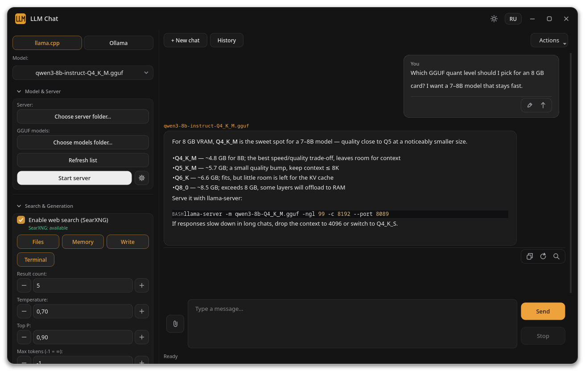
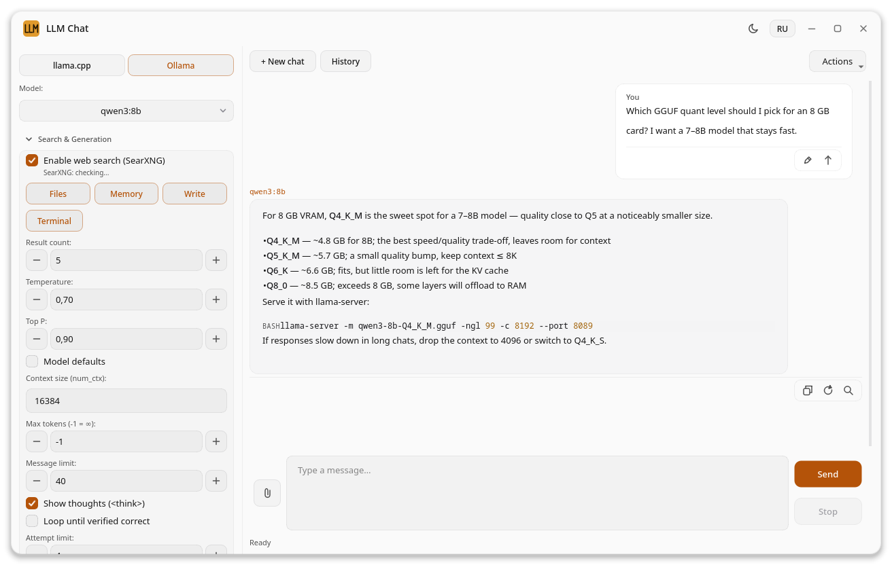
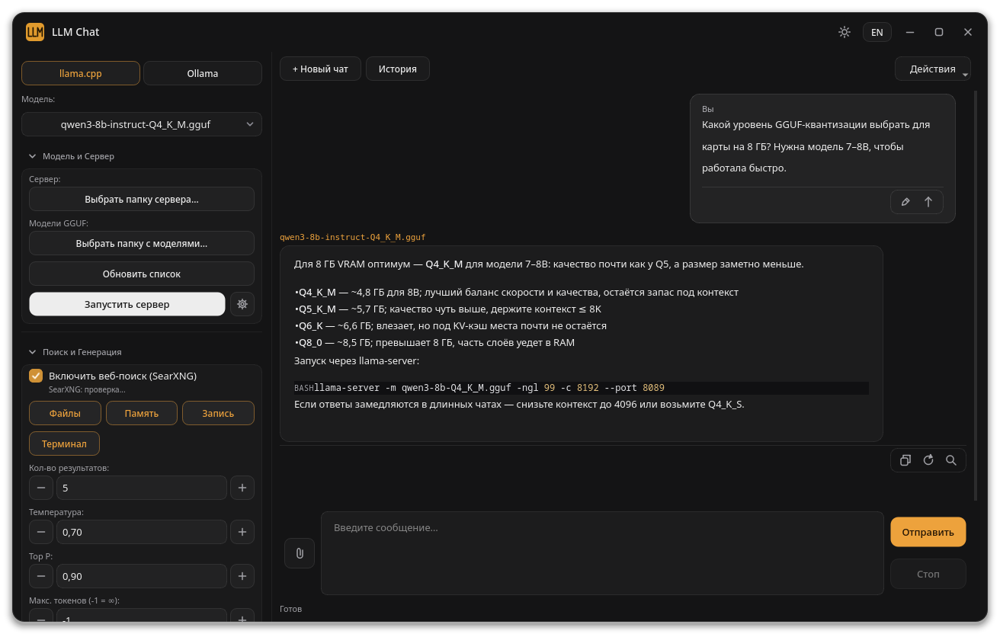
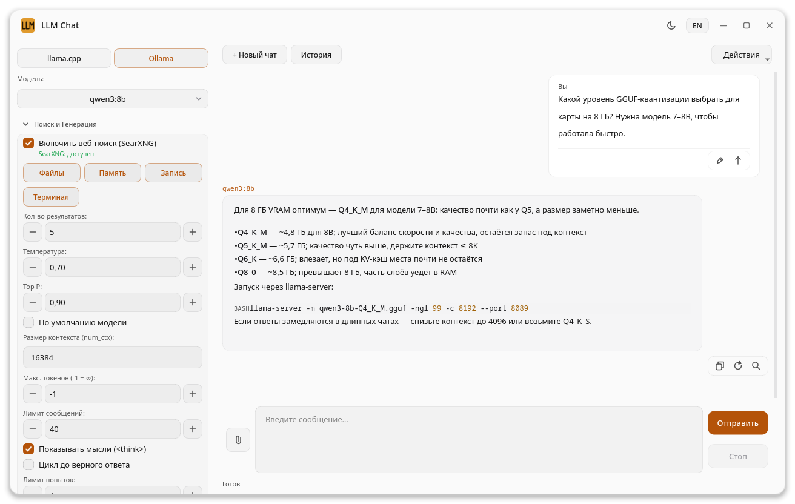

# LocalLLM-Chat

[English](#english) | [Русский](#русский)

---

## English

A desktop chat client for local LLMs with two backends — **llama.cpp** and **Ollama** — in a single window. Both backends share the same chat history and long-term memory, so you can switch between them at any moment without losing context.

Built with Python and PyQt6. Linux.

<p align="center">
  
  
</p>

### Features

- **Two backends, one app** — llama.cpp (`llama-server` is started and managed by the app) and Ollama; backend switch lives in the sidebar, chats and memory are shared between both
- **Tool calling** — web search (SearXNG), web page scraping, reading local text/PDF files, writing text files, and a terminal with a command deny-list; calls and results are shown as separate cards in the feed
- **Long-term memory** — a small SQLite database the model can read and write across chats (`memory_write` / `memory_read` / `memory_delete`)
- **Streaming with markdown** — live output, headings, tables, syntax-highlighted code blocks (Pygments)
- **Thinking blocks** — `<think>…</think>` reasoning is collapsed into a toggleable section
- **Chat history** — named chats, model-generated titles, export to `.txt`
- **Generation controls** — system prompt, temperature, top-p, context size, max tokens, per-tool on/off switches
- **Themes and languages** — dark and light themes; Russian and English interface
- **Portable build** — a single-file binary that runs without installing Python (see [docs/PORTABLE.md](docs/PORTABLE.md))

### Requirements

- Linux with glibc ≥ 2.28 (Ubuntu 20.04+, Debian 10+, Fedora 30+, Arch/CachyOS, …)
- Python 3.10+
- One of the backends:
  - **llama.cpp** — a folder with `bin/llama-server` and a folder with GGUF models
  - **Ollama** — the standard service on `localhost:11434`
- Optional: a local [SearXNG](https://docs.searxng.org/) instance on `localhost:8080` for web search

### Install and run

```bash
pip install -r requirements.txt
cd app
python3 main.py
```

The `data/` folder next to `app/` stores chats, memory and settings; it is created on first launch.

### Tests

```bash
pip install pytest
python3 -m pytest LLM-Chat-Common/tests/
```

---

## Русский

Локальный чат для своих моделей с двумя бэкендами — **llama.cpp** и **Ollama** — в одном окне. Оба бэкенда пользуются общей историей чатов и общей долговременной памятью, поэтому переключаться между ними можно в любой момент без потери контекста.

Написан на Python (PyQt6). Платформа — Linux.

<p align="center">
  
  
</p>

### Возможности

- **Два бэкенда в одном приложении.** llama.cpp: приложение само запускает и останавливает `llama-server` (порт, потоки, `-ngl`, контекст, draft-модель для MTP настраиваются в интерфейсе), модели берутся из папки GGUF. Ollama: обычная служба на `localhost:11434`, с поддержкой нативных вызовов инструментов.
- **Вызовы инструментов.** Веб-поиск через локальный SearXNG, парсинг веб-страниц, чтение локальных файлов (текст и PDF), запись текстовых файлов, терминал с deny-листом опасных команд. Вызовы и результаты отображаются отдельными карточками в ленте.
- **Долговременная память.** SQLite-база (`data/memory.db`), которую модель читает и пишет сама между чатами: факты, предпочтения, заметки.
- **Стриминг и markdown.** Ответ печатается по мере генерации; лента рендерит заголовки, таблицы, код с подсветкой (Pygments).
- **Блоки размышлений.** `<think>…</think>` сворачиваются в отдельный раскрывающийся блок.
- **История чатов.** Именованные чаты, автозаголовки от модели, экспорт в `.txt`.
- **Настройки генерации.** Системный промпт, температура, top-p, размер контекста, лимит токенов, отдельные тумблеры для каждого инструмента.
- **Темы и языки.** Тёмная и светлая темы, русский и английский интерфейс (переключение применяется после перезапуска).
- **Портативная сборка.** Один файл без установки Python и зависимостей — [docs/PORTABLE.md](docs/PORTABLE.md), либо возьмите готовый бинарник в [Releases](../../releases).

### Зависимости

| Пакет | Назначение |
|---|---|
| [PyQt6](https://pypi.org/project/PyQt6/) | интерфейс (Qt6) |
| [requests](https://pypi.org/project/requests/) | HTTP: API бэкендов, SearXNG, парсинг |
| [beautifulsoup4](https://pypi.org/project/beautifulsoup4/) | разбор HTML при поиске и парсинге |
| [pygments](https://pypi.org/project/pygments/) | подсветка кода в ответах |
| [pypdf](https://pypi.org/project/pypdf/) | чтение PDF (инструмент `read_pdf`) |

`pytest` нужен только для тестов.

### Установка и запуск

```bash
pip install -r requirements.txt
cd app
python3 main.py
```

Данные (чаты, память, настройки) лежат в папке `data/` рядом с `app/` и создаются при первом запуске.

### Веб-поиск

Поиск работает через локальный экземпляр [SearXNG](https://docs.searxng.org/) (`localhost:8080`). Если он не запущен, приложение продолжает работать — инструмент поиска просто отключается.

### Тесты

```bash
pip install pytest
python3 -m pytest LLM-Chat-Common/tests/
```

---

## License / Лицензия

[MIT](LICENSE)
